# Buku Panduan Tenant Operation

**Aplikasi Billing ISP — Kalimasada Inti Sarana**

Panduan operasional untuk administrator tenant: dari setup awal (RADIUS, NAS, paket) hingga operasional harian (pelanggan, invoice, keuangan, gudang, absensi, dan kerja teknisi), plus ringkasan portal lapangan (Teknisi, Kolektor, Agent).

---

## Cara memakai buku ini

1. Ikuti **Bab 2** berurutan saat setup pertama kali.
2. Gunakan **Bab 3–8** sebagai referensi operasional harian.
3. Serahkan **Bab 9** ke staf lapangan (teknisi / kolektor / agent).
4. Jika ada error, mulai dari **Bab 10**.

Setiap langkah menyebut **Menu** persis seperti di sidebar Admin Panel. Gambar diberi nomor `Gambar X.Y` dan ditempatkan di dekat langkah terkait.

> **Catatan keamanan:** Jangan bagikan password admin. Gunakan placeholder di dokumentasi internal Anda.

---

## Daftar Isi

1. [Pengenalan & Akses](#bab-1--pengenalan--akses)
2. [Setup Aplikasi Billing](#bab-2--setup-aplikasi-billing)
3. [Pelanggan](#bab-3--pelanggan)
4. [Invoicing & Keuangan](#bab-4--invoicing--keuangan)
5. [Hotspot & Agent](#bab-5--hotspot--agent)
6. [Manajemen Gudang](#bab-6--manajemen-gudang)
7. [Karyawan & Absensi](#bab-7--karyawan--absensi)
8. [Kerja Teknisi (sisi Admin)](#bab-8--kerja-teknisi-sisi-admin)
9. [Portal Lapangan](#bab-9--portal-lapangan)
10. [Troubleshooting Singkat](#bab-10--troubleshooting-singkat)
11. [Checklist Siap Produksi](#checklist-siap-produksi)

---

## Bab 1 — Pengenalan & Akses

### 1.1 Apa itu panel Admin Tenant?

Panel Admin Tenant adalah pusat kontrol ISP Anda: mengelola pelanggan PPPoE/hotspot, tagihan, pembayaran, stok gudang, absensi karyawan, penugasan teknisi, serta pengaturan RADIUS/NAS/MikroTik.

### 1.2 Peran pengguna

| Peran | Portal | Tugas utama |
|-------|--------|-------------|
| **Admin** | `/login` → `/admin/dashboard` | Setup, pelanggan, invoice, keuangan, master data |
| **Teknisi** | Portal teknisi | Instalasi, gangguan, monitoring lapangan |
| **Kolektor** | Portal kolektor | Tagih pelanggan, setoran |
| **Agent** | Portal agent | Jual voucher, cek saldo |

### 1.3 Login Admin

1. Buka URL tenant Anda (contoh: `https://NAMA_TENANT.domain-anda.com/login` atau `http://IP:PORT/login?tenant=NAMA_TENANT`).
2. Pilih peran **Admin** (jika ada pilihan peran).
3. Isi **username** dan **password** admin.
4. Klik **Login**. Anda diarahkan ke Dashboard.

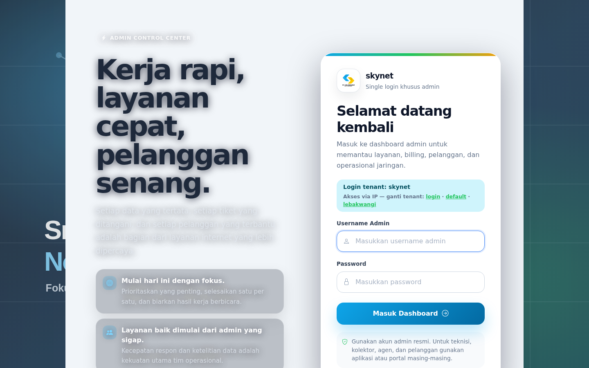

*Gambar 1.1 — Halaman login aplikasi*

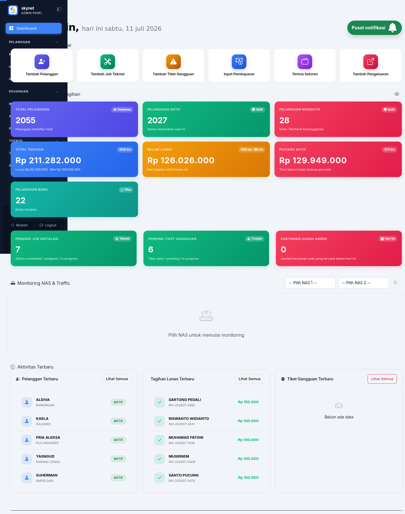

*Gambar 1.2 — Dashboard Admin setelah login*

### 1.4 Navigasi sidebar

Menu utama di kiri (Desktop) atau lewat ikon hamburger (Mobile):

- **Dashboard** — ringkasan operasional
- **Pelanggan** — pelanggan, area, paket, isolir
- **PPP Connection** — user/profile PPPoE, GenieACS
- **Hotspot & Voucher** — NAS, voucher, member
- **Invoicing** — buat & daftar invoice
- **Keuangan** — pembayaran, kolektor, laporan
- **Manajemen Gudang** — stok barang
- **Agent** — pendaftaran & kelola agent
- **Karyawan** — absensi & HR
- **Teknisi** — akun teknisi, instalasi, trouble
- **Tools & Reporting** — OLT, ODP, kabel, mapping
- **Settingan** — konfigurasi sistem

---

## Bab 2 — Setup Aplikasi Billing

Ikuti urutan di bawah **sebelum** menambah pelanggan massal. Setup yang acak sering menyebabkan user tidak bisa login atau isolir tidak jalan.

### Alur setup (ringkas)

```
Setting Umum → RADIUS → Kelola NAS / Mikrotik → Profile PPPoE/Hotspot
→ Paket & Area → WhatsApp / Email / Payment → Auto Isolir → Checklist
```

---

### STEP 1 — Setting Umum

**Menu:** Settingan → **Setting Umum** (`/admin/settings`)

**Tujuan:** Identitas perusahaan, kontak, rekening, dan nomor admin.

1. Isi **nama perusahaan**, slogan, website, dan upload **logo**.
2. Isi **telepon, email, alamat, WhatsApp CS**.
3. Isi data pembayaran: bank, nomor rekening, atas nama, alamat/jam kas.
4. Tambahkan nomor WhatsApp **admin** (format `628xxxxxxxxxx`).
5. Simpan.

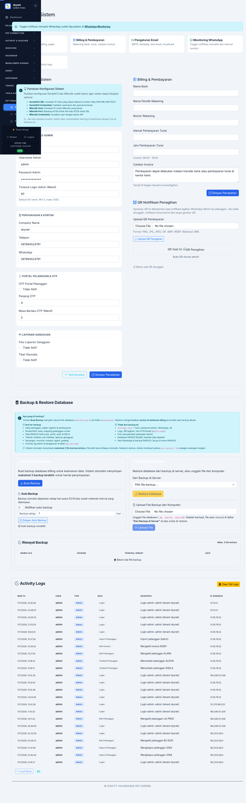

*Gambar 2.1 — Setting Umum*

> **Tip:** Ubah password admin dari nilai default segera setelah login pertama.

---

### STEP 2 — Setting RADIUS

**Menu:** Settingan → **Setting RADIUS** (`/admin/radius`)

**Tujuan:** Menghubungkan billing ke database FreeRADIUS (autentikasi PPPoE/hotspot).

1. Isi **RADIUS Host** (`localhost` jika di server yang sama, atau IP FreeRADIUS).
2. Isi **User**, **Password**, dan **Database** (umumnya `radius`).
3. Klik **Test Koneksi**. Pastikan berhasil.
4. Klik **Simpan**.

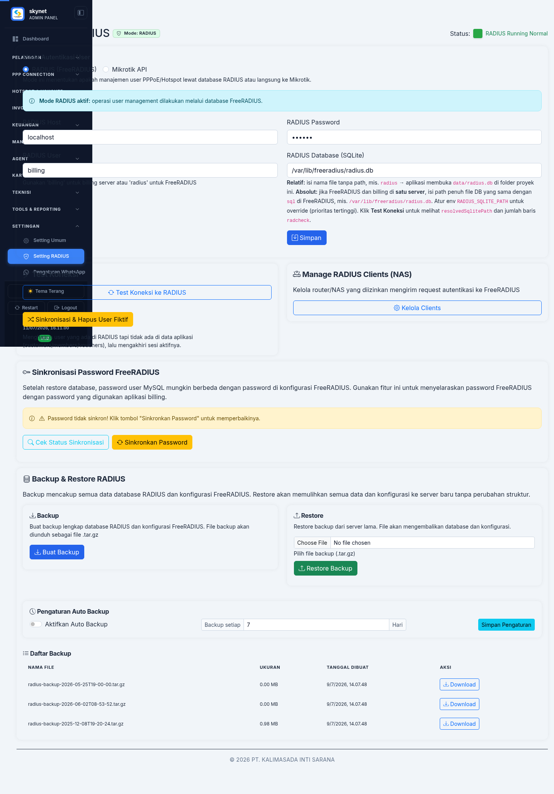

*Gambar 2.2 — Setting RADIUS*

> **Jika gagal:** Pastikan FreeRADIUS running, user DB punya privilege, dan firewall tidak memblokir MySQL/MariaDB.

---

### STEP 3 — Kelola NAS (Router sebagai client RADIUS)

**Menu:** Hotspot & Voucher → **Kelola NAS** (`/admin/routers`)

**Tujuan:** Mendaftarkan router MikroTik sebagai NAS di RADIUS.

1. Klik tambah NAS / router.
2. Isi nama, **IP NAS**, secret RADIUS (harus sama dengan di MikroTik), dan keterangan.
3. Simpan.
4. Pastikan di MikroTik: `/radius` mengarah ke server RADIUS billing, secret cocok, dan service PPPoE/hotspot diaktifkan.

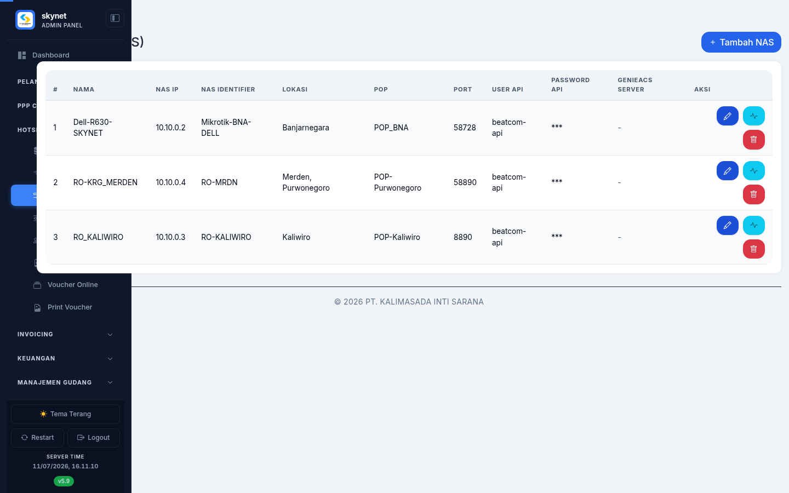

*Gambar 2.3 — Kelola NAS*

---

### STEP 4 — Setting Mikrotik & GenieACS

**Menu:** Settingan → **Setting Mikrotik** (`/admin/connection-settings`)

**Tujuan:** Koneksi API MikroTik (monitoring/operasi tambahan) dan server GenieACS (ONU/CPE).

1. Tab **Routers**: tambah nama, IP, port API (default `8728`), user & password API.
2. Tab / menu **GenieACS**: isi URL ACS, username, password.
3. Test koneksi jika tersedia, lalu simpan.

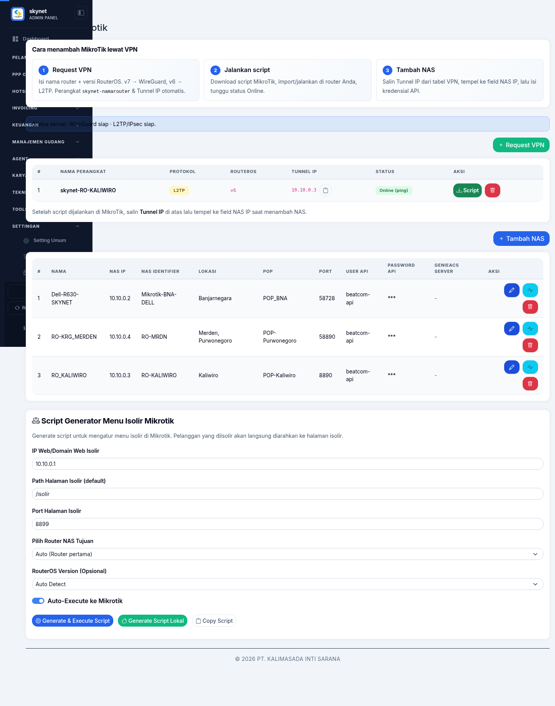

*Gambar 2.4 — Setting Mikrotik*

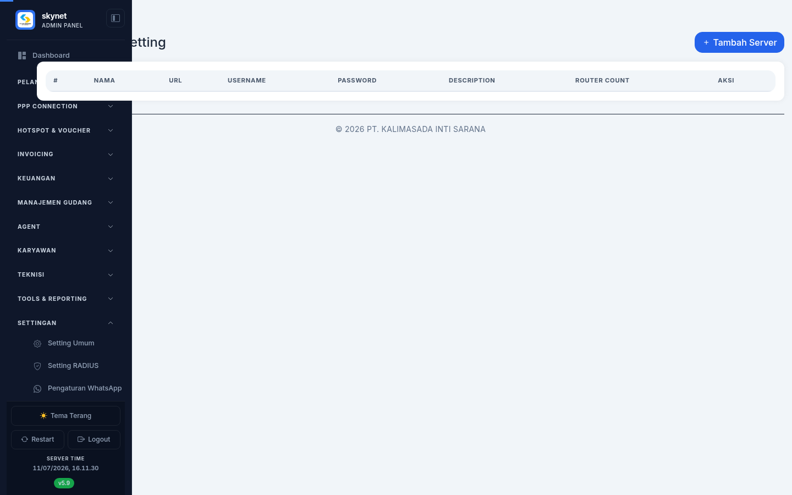

*Gambar 2.5 — GenieACS Setting*

---

### STEP 5 — Profile PPPoE

**Menu:** PPP Connection → **Profile PPPoE** (`/admin/mikrotik/profiles`)

**Tujuan:** Profile kecepatan yang nanti dipasangkan ke paket internet.

1. Buat profile sesuai paket (contoh: `10M`, `20M`).
2. Isi **Remote Address** dengan **nama pool** di MikroTik (contoh: `pool-10m`), bukan CIDR.
3. Pastikan profile tersinkron ke RADIUS (atribut `Framed-Pool`).
4. (Opsional) Buat profile **isolir** untuk penangguhan.

#### Multi-router: nama pool sama, subnet beda

Jika tenant punya beberapa MikroTik (NAS), pola yang didukung:

| Router | Nama pool | Ranges (contoh) |
|--------|-----------|-----------------|
| RO-A | `pool-10m` | `10.10.10.2-10.10.10.254` |
| RO-B | `pool-10m` | `10.10.20.2-10.10.20.254` |
| RO-C | `pool-10m` | `10.10.30.2-10.10.30.254` |

- Cukup **satu** profile di billing dengan Remote Address = `pool-10m`.
- RADIUS mengirim nama pool saja; **masing-masing** MikroTik mengalokasikan IP dari `/ip pool` lokalnya.
- Di setiap router: buat pool dengan nama **persis sama** (case-sensitive), set `local-address` PPP se-subnet dengan pool itu, dan daftarkan NAS + secret RADIUS yang cocok.
- Format ranges MikroTik: `start-end` (lebih aman daripada CIDR).

Jika pelanggan tidak bisa konek, bedakan: auth reject (NAS/secret/user) vs auth OK tapi tanpa IP (pool hilang / nama beda / `local-address` salah).

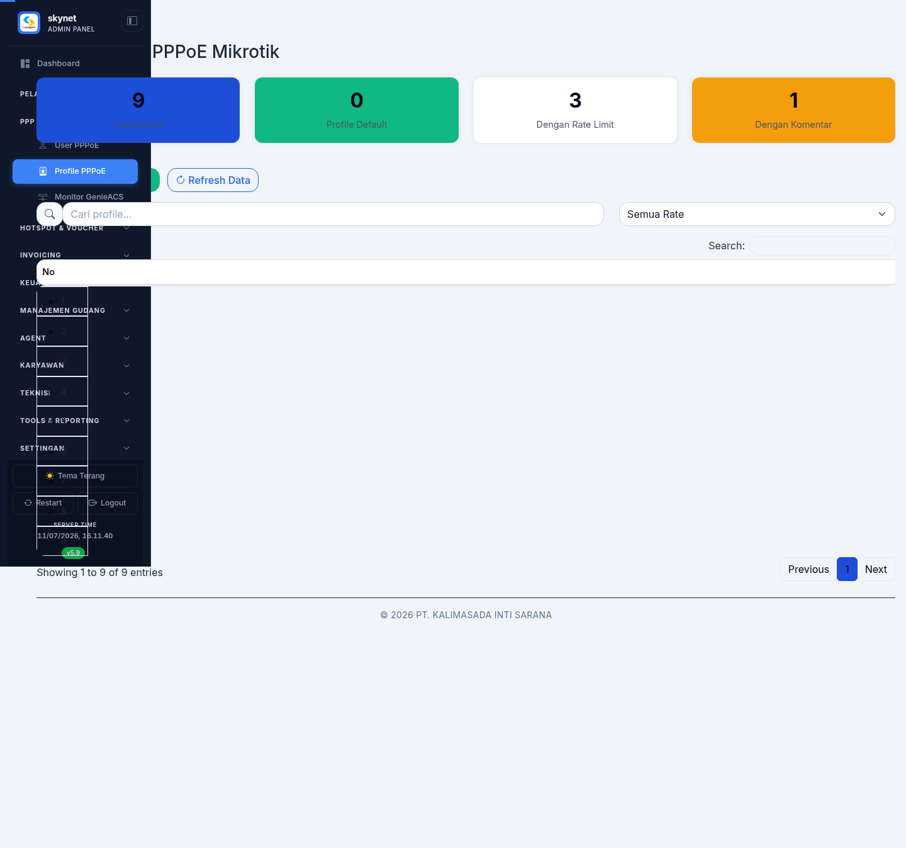

*Gambar 2.6 — Profile PPPoE*

---

### STEP 6 — Paket Internet & Area

**Menu:** Pelanggan → **Paket internet** (`/admin/billing/packages`)

1. Tambah paket: nama, kecepatan, harga, PPN (jika ada), hubungkan ke **profile PPPoE**.
2. Simpan.

**Menu:** Pelanggan → **Manajemen Area** (`/admin/billing/areas`)

1. Buat area layanan (desa/cluster).
2. (Opsional) **Area Kolektor** untuk membagi wilayah penagihan.

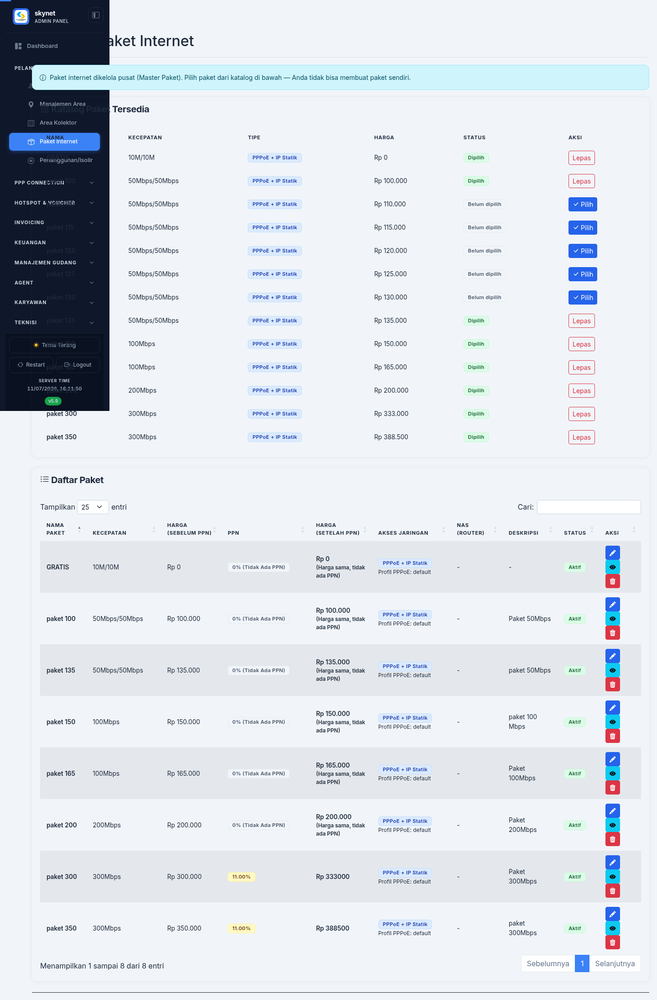

*Gambar 2.7 — Paket Internet*

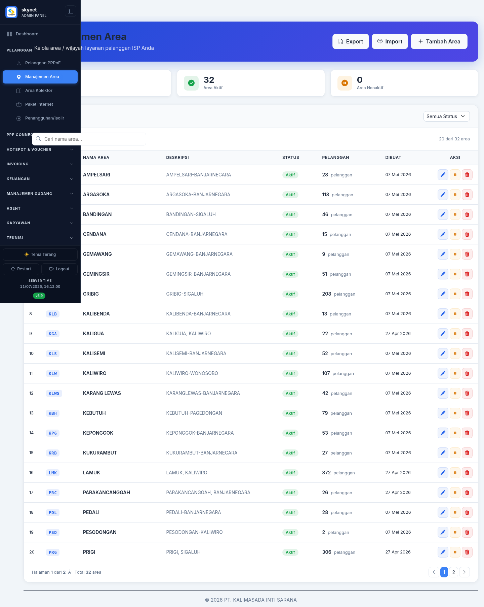

*Gambar 2.8 — Manajemen Area*

---

### STEP 7 — WhatsApp, Email, Pembayaran

**WhatsApp** — Settingan → **Pengaturan WhatsApp** (`/admin/billing/whatsapp-settings`)

1. Hubungkan gateway / scan QR sesuai provider.
2. Pastikan status **Connected**.
3. Atur template notifikasi tagihan/isolir.

**Email** — Settingan → **Pengaturan Email** (`/admin/billing/email-settings`)

1. Isi SMTP host, port, user, password, pengirim.
2. Kirim email uji.

**Pembayaran** — Keuangan → **Pengaturan Pembayaran** (`/admin/billing/payment-settings`)

1. Aktifkan gateway (Midtrans / Duitku / Xendit / transfer bank) sesuai yang dipakai.
2. Simpan kunci API di tempat aman.

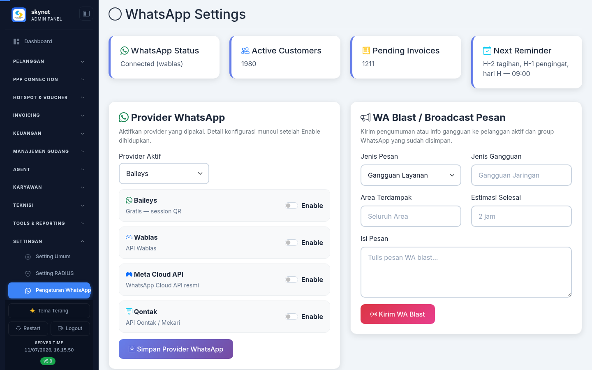

*Gambar 2.9 — Pengaturan WhatsApp*

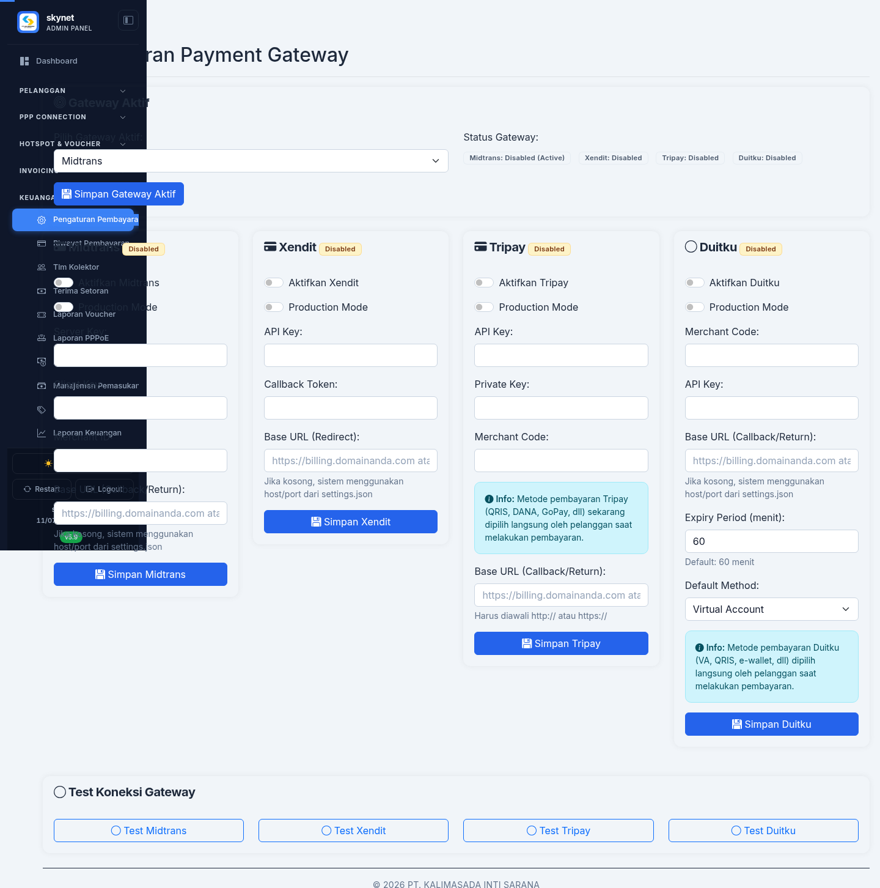

*Gambar 2.10 — Pengaturan Pembayaran*

---

### STEP 8 — Auto Isolir / Penangguhan

**Menu:** Pelanggan → **Penangguhan/Isolir** (`/admin/billing/service-suspension`)  
dan/atau tab Auto Suspension di Setting Umum.

1. Aktifkan auto suspension.
2. Set **hari tenggang** (grace period).
3. Set **profile isolir** yang sudah ada di RADIUS.
4. Simpan dan uji pada 1 pelanggan uji coba.

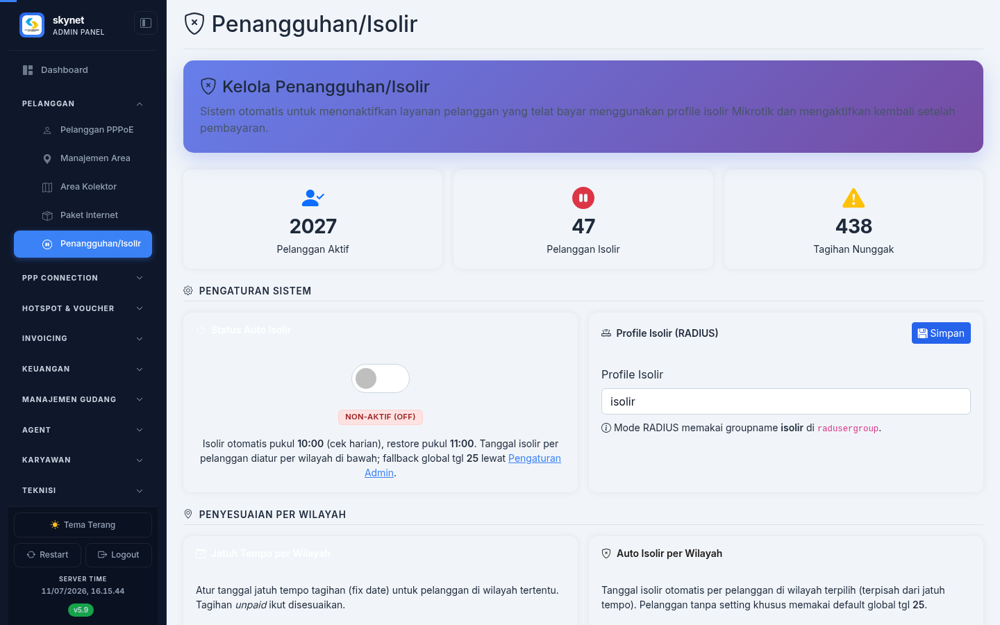

*Gambar 2.11 — Penangguhan/Isolir*

Setelah STEP 1–8 selesai, lanjut ke Bab 3 untuk menambah pelanggan.

---

## Bab 3 — Pelanggan

### 3.1 Tambah pelanggan PPPoE

**Menu:** Pelanggan → **Pelanggan PPPoE** (`/admin/billing/customers`)

1. Klik **Tambah Pelanggan**.
2. Isi data wajib: nama, telepon/WhatsApp, alamat, area, paket.
3. Isi kredensial PPPoE (username/password) atau biarkan sistem generate (jika tersedia).
4. Simpan.
5. Verifikasi pelanggan muncul di daftar dan (jika RADIUS OK) bisa autentikasi di jaringan.

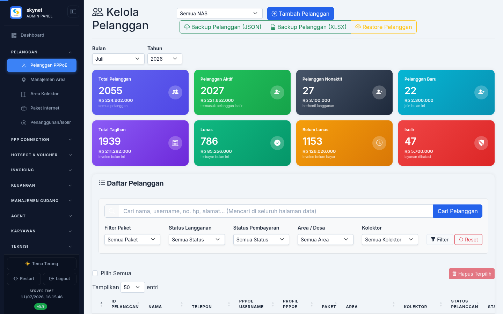

*Gambar 3.1 — Daftar Pelanggan PPPoE*

### 3.2 Detail pelanggan

Buka pelanggan dari daftar untuk:

- Melihat invoice & status layanan
- Edit data / ganti paket
- Isolir atau restore manual
- Lihat info ONU (jika GenieACS terhubung)

### 3.3 User PPPoE & monitoring

**Menu:** PPP Connection → **User PPPoE** (`/admin/mikrotik`) — status online/offline.  
**Menu:** PPP Connection → **Monitor GenieACS** (`/admin/genieacs`) — perangkat CPE/ONU.

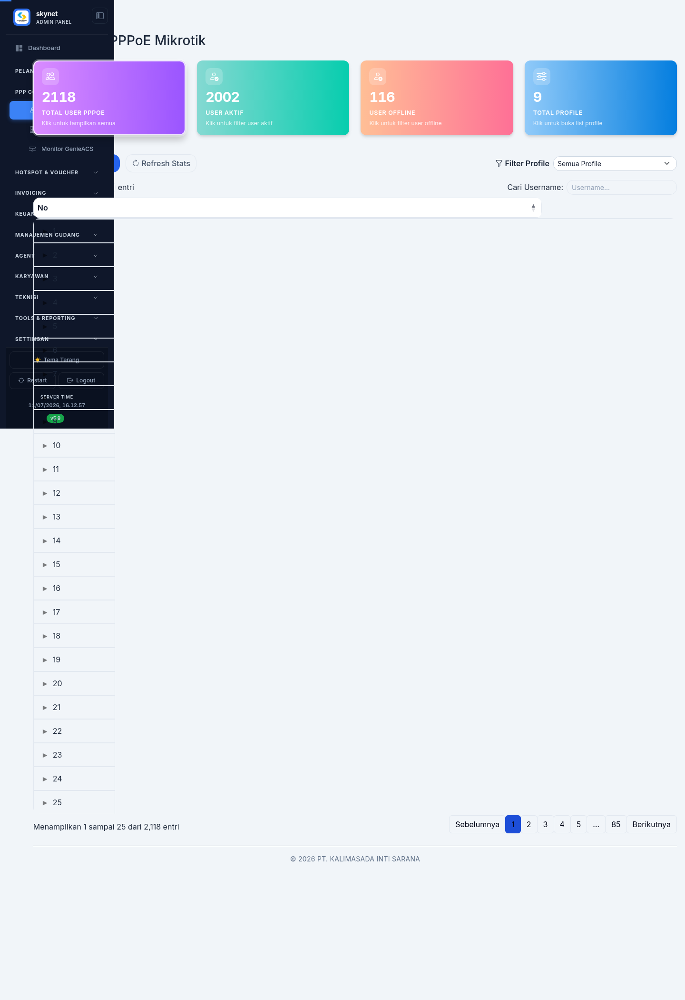

*Gambar 3.2 — User PPPoE*

### 3.4 Mapping jaringan (ringkas)

**Menu:** Tools & Reporting → **Network Mapping** (`/admin/billing/mapping-new`)

Gunakan peta untuk melihat posisi pelanggan/ODP. Pastikan koordinat pelanggan sudah diisi agar mapping berguna.

---

## Bab 4 — Invoicing & Keuangan

### 4.1 Buat invoice manual

**Menu:** Invoicing → **Buat Invoice** (`/admin/billing/invoices`)

1. Pilih pelanggan / periode.
2. Pastikan nominal sesuai paket.
3. Simpan / terbitkan.
4. (Opsional) Kirim notifikasi WhatsApp.

### 4.2 Auto Invoice

**Menu:** Invoicing → **Auto Invoice** (`/admin/billing/auto-invoice`)

1. Aktifkan jadwal generate bulanan.
2. Set tanggal generate dan aturan pelanggan yang ikut.
3. Monitor status generate terakhir.

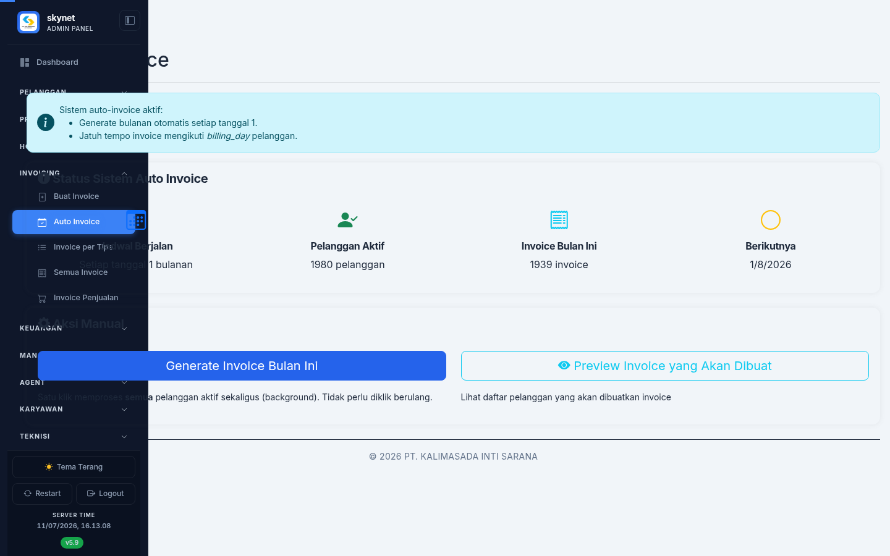

*Gambar 4.1 — Auto Invoice*

### 4.3 Daftar invoice

**Menu:** Invoicing → **Semua Invoice** / **Invoice per Tipe**

Gunakan untuk cari tagihan unpaid, cetak, atau edit.

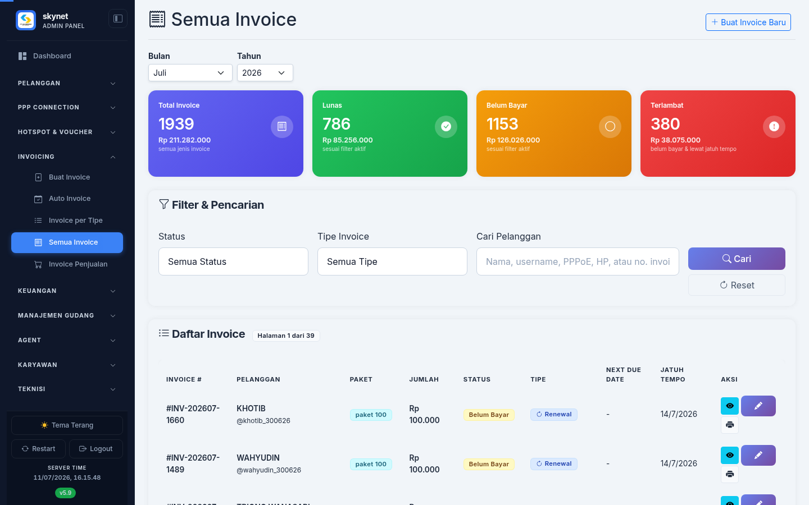

*Gambar 4.2 — Semua Invoice*

### 4.4 Pembayaran

**Menu:** Keuangan → **Riwayat Pembayaran** (`/admin/billing/all-payments`)

- Pantau pembayaran gateway & manual.
- Cocokkan dengan invoice yang lunas.

### 4.5 Kolektor & setoran

1. **Tim Kolektor** (`/admin/collectors`) — buat akun kolektor.
2. Assign area di **Area Kolektor**.
3. Kolektor menagih lewat portal kolektor.
4. Admin menerima setoran di **Terima Setoran** (`/admin/billing/collector-remittance`).

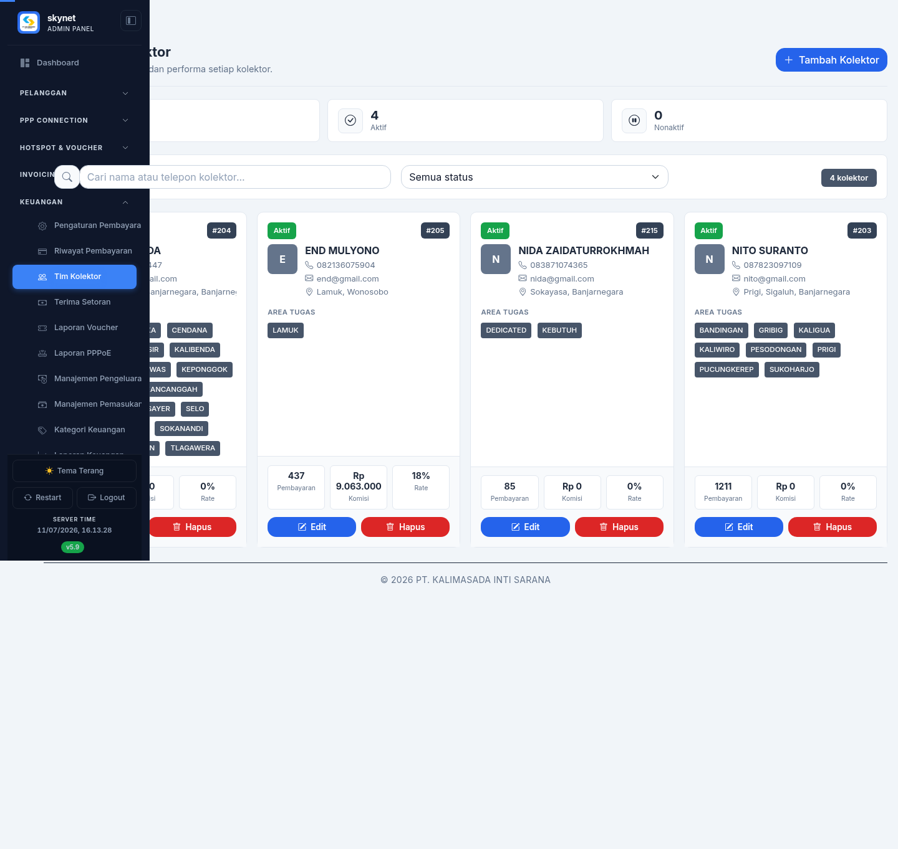

*Gambar 4.3 — Tim Kolektor*

### 4.6 Pemasukan, pengeluaran, laporan

| Menu | Fungsi |
|------|--------|
| Manajemen Pengeluaran | Catat biaya operasional |
| Manajemen Pemasukan | Catat pemasukan non-tagihan |
| Kategori Keuangan | Kelompokkan transaksi |
| Laporan Keuangan | Ringkasan laba/rugi operasional |
| Laporan PPPoE / Voucher | Omzet per layanan |

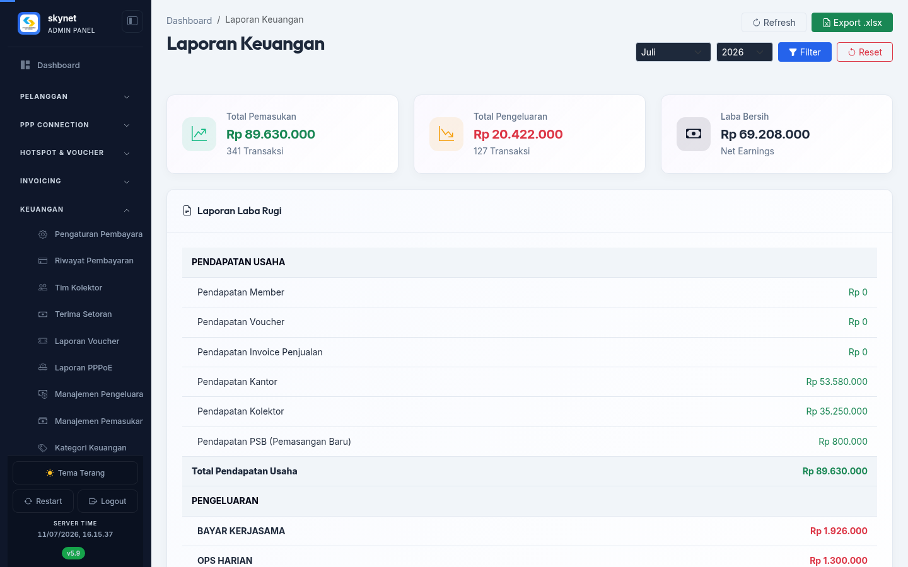

*Gambar 4.4 — Laporan Keuangan*

---

## Bab 5 — Hotspot & Agent

Gunakan bab ini jika bisnis Anda menjual voucher hotspot.

### 5.1 Profile & server hotspot

1. **Server Hotspot** — profil server di MikroTik/RADIUS.
2. **Users Profiles** — profil user (durasi, bandwidth, harga).

### 5.2 Buat & cetak voucher

**Menu:** Hotspot & Voucher → **Buat Voucher** → **List Voucher** → **Print Voucher**

1. Pilih profil & jumlah.
2. Generate.
3. Cetak dengan template yang sudah diatur.

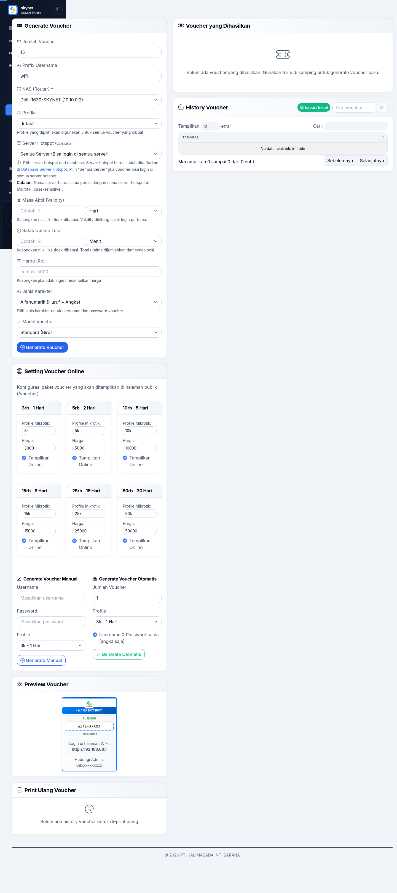

*Gambar 5.1 — Buat Voucher*

### 5.3 Agent

1. **Pendaftaran Agent** — setujui calon agent.
2. **Web Agent** — kelola saldo, status, dan data agent.
3. Agent login ke portal agent untuk jual voucher.

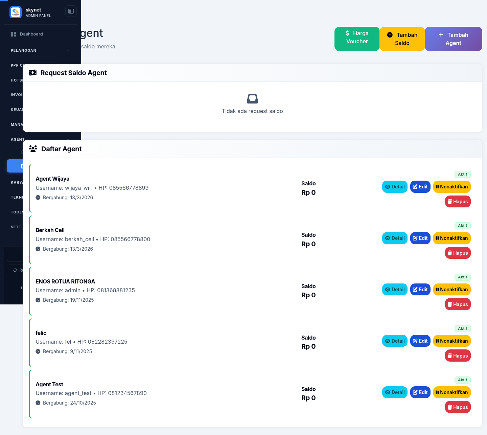

*Gambar 5.2 — Web Agent*

---

## Bab 6 — Manajemen Gudang

**Urutan kerja yang disarankan:** Nama Barang → Barang Masuk → Barang Keluar → Laporan → Cetak QR.

1. **Nama Barang** — master item (ONU, kabel, splitter, dll.).
2. **Barang Masuk** — catat pembelian/stok masuk.
3. **Barang Keluar** — stok keluar ke teknisi / pemasangan.
4. **Laporan Barang** — stok aktual & riwayat.
5. Cetak QR batch jika memakai pelacakan barcode.

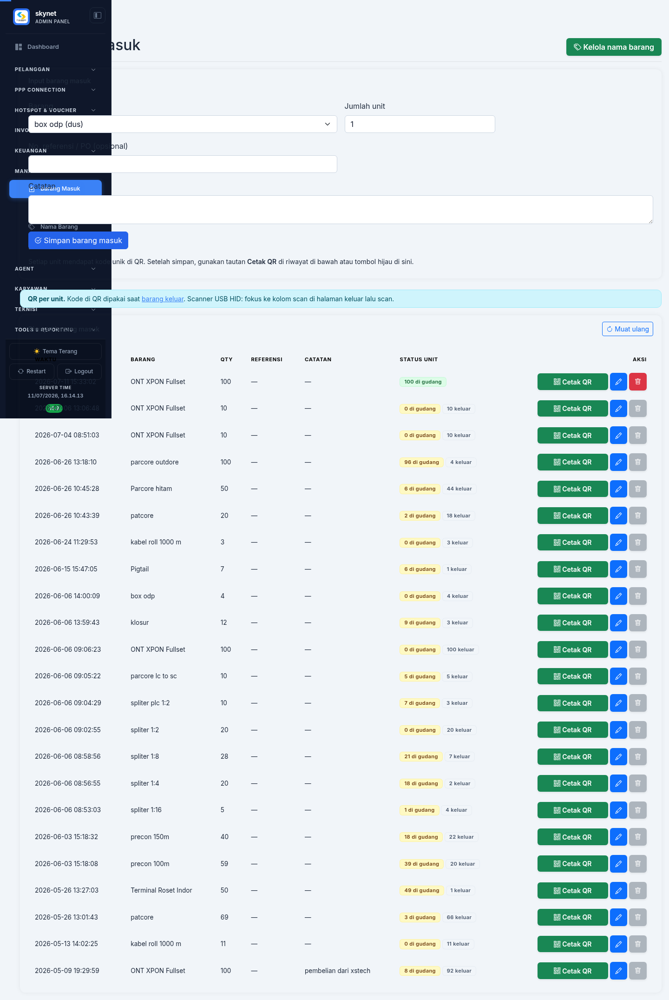

*Gambar 6.1 — Barang Masuk*

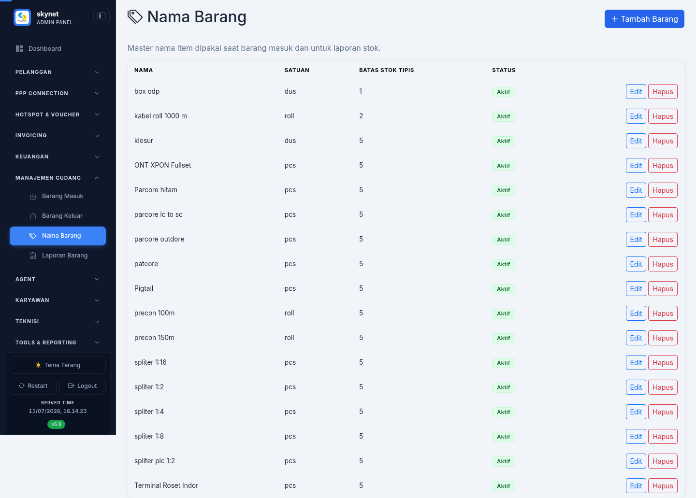

*Gambar 6.2 — Nama Barang*

---

## Bab 7 — Karyawan & Absensi

1. **Master Data** (`/admin/employees`) — daftar karyawan.
2. **Setelan Absensi** — aturan QR / geofence / jam kerja.
3. **Absensi** — pantau kehadiran harian.
4. **Permintaan Izin/Cuti** — setujui atau tolak.
5. **Penggajian** — proses gaji berdasarkan data absensi.
6. **Laporan** — rekap HR.

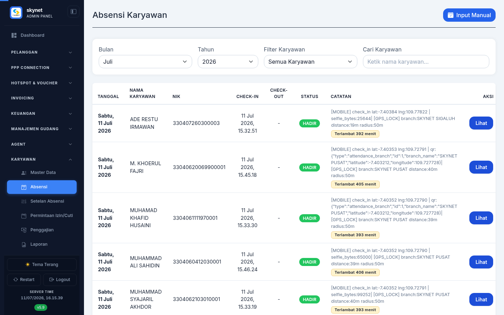

*Gambar 7.1 — Absensi Karyawan*

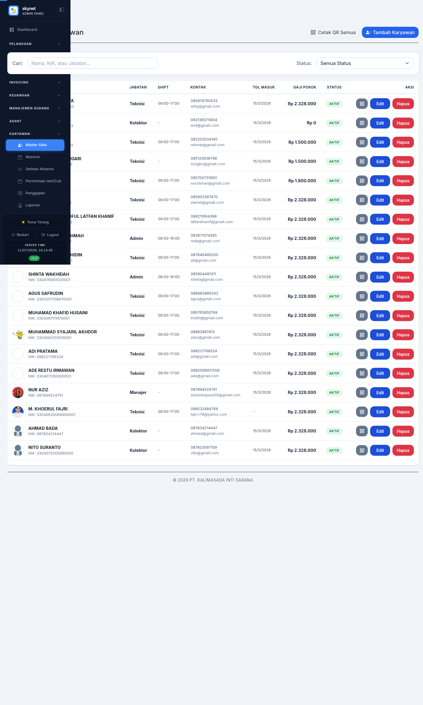

*Gambar 7.2 — Master Data Karyawan*

---

## Bab 8 — Kerja Teknisi (sisi Admin)

### 8.1 Kelola Teknisi

**Menu:** Teknisi → **Kelola Teknisi** (`/admin/technicians`)

Buat akun teknisi (telepon/password) agar bisa login portal lapangan.

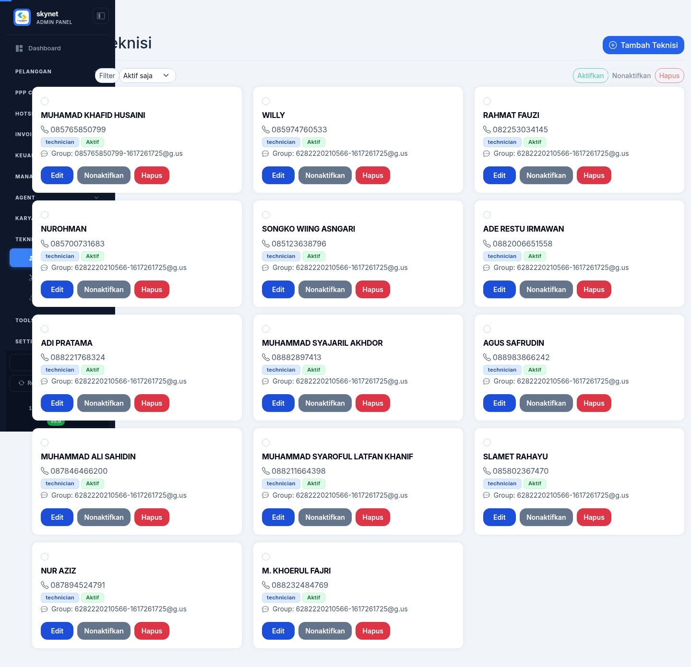

*Gambar 8.1 — Kelola Teknisi*

### 8.2 Installation Jobs

**Menu:** Teknisi → **Installation Jobs** (`/admin/installations`)

1. Buat job pemasangan baru.
2. Assign teknisi & jadwal.
3. Pantau status hingga selesai.

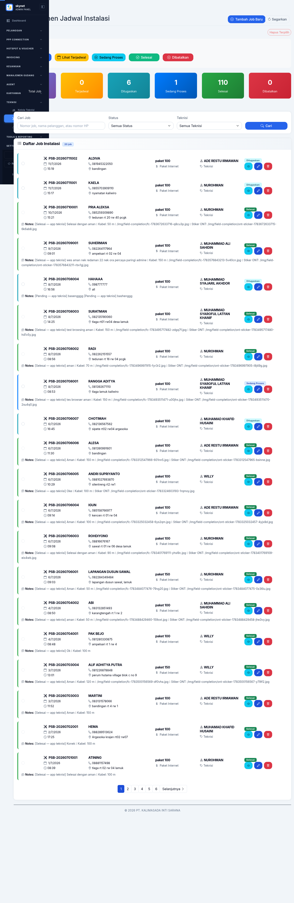

*Gambar 8.2 — Installation Jobs*

### 8.3 Trouble Report

**Menu:** Teknisi → **Trouble Report** (`/admin/trouble`)

1. Lihat tiket gangguan dari pelanggan/admin.
2. Assign teknisi.
3. Tutup tiket setelah resolved.

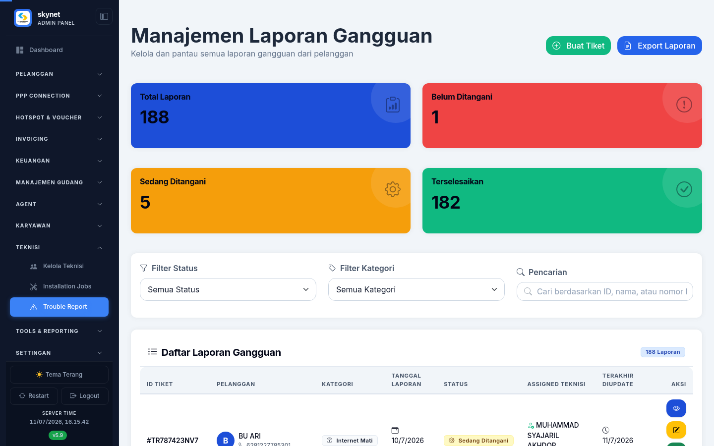

*Gambar 8.3 — Trouble Report*

### 8.4 Tools jaringan (ringkas)

| Menu | Kegunaan |
|------|----------|
| OLT Management | Pantau OLT/ONU |
| ODP Management | Kapasitas port ODP |
| Cable Routes | Rute kabel fiber |
| Network Analytics | Analisis jaringan |
| Network Mapping | Peta aset & pelanggan |

Isi data ODP/kabel sebelum mapping dipakai penuh di lapangan.

---

## Bab 9 — Portal Lapangan

### 9.1 Portal Teknisi

Teknisi login ke portal teknisi, lalu memakai menu:

- **Dashboard** — ringkasan tugas
- **Instalasi** — kerjakan job pemasangan
- **Gangguan** — kerjakan trouble ticket
- **Monitoring / Mapping** — cek perangkat & lokasi
- **Pelanggan** — data pelanggan lapangan (sesuai hak akses)


*Gambar 9.1 — Portal Teknisi*

### 9.2 Portal Kolektor

- **Pelanggan** di area yang di-assign
- **Bayar** — catat pembayaran lapangan
- **Setoran** — setor ke admin
- **Profil** — ubah data/password

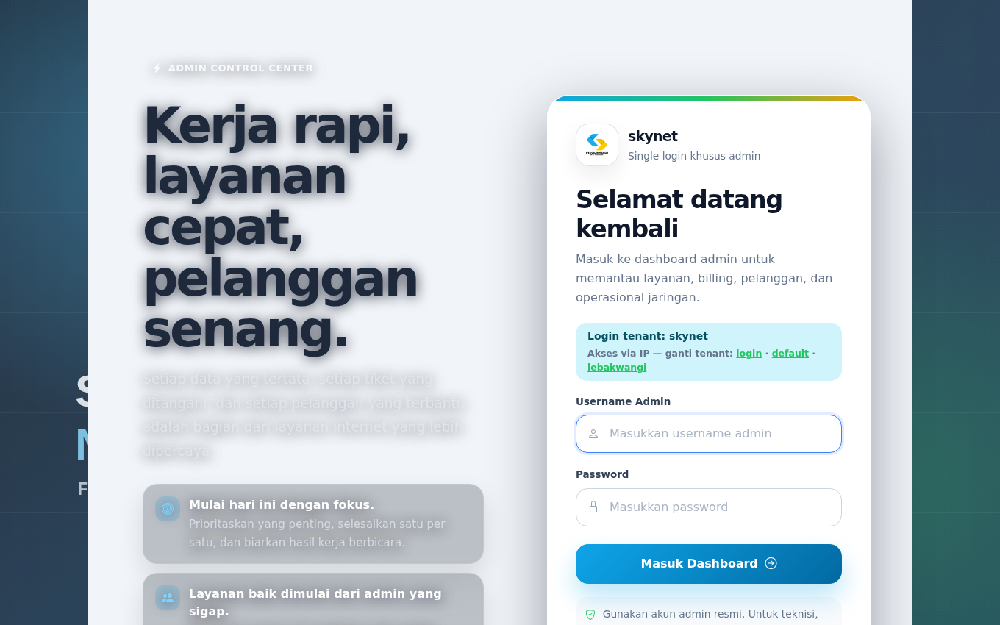

*Gambar 9.2 — Portal Kolektor*

### 9.3 Portal Agent

- **Voucher** — jual / generate sesuai kuota
- **Saldo & Transaksi** — pantau deposit
- **Pembayaran** — riwayat top-up / pembayaran agent


*Gambar 9.3 — Portal Agent*

---

## Bab 10 — Troubleshooting Singkat

### RADIUS tidak connect

1. Settingan → Setting RADIUS → **Test Koneksi**.
2. Pastikan FreeRADIUS running.
3. Cek user/password/database MySQL RADIUS.
4. Pastikan MikroTik `/radius` mengarah ke IP server yang benar dan secret cocok dengan **Kelola NAS**.

### Pelanggan tidak bisa login PPPoE

1. Cek username di Pelanggan / User PPPoE.
2. Cek profile & group di RADIUS.
3. Cek status isolir.
4. Cek log FreeRADIUS dan status NAS.

### Isolir tidak jalan

1. Pastikan auto suspension aktif dan grace period benar.
2. Pastikan **profile isolir** ada di RADIUS.
3. Uji isolir manual pada satu pelanggan.
4. Lihat dokumentasi internal: `docs/ALUR_ISOLIR_RESTORE.md`.

### WhatsApp tidak kirim

1. Cek Monitoring WhatsApp — status harus Connected.
2. Refresh/scan ulang QR jika putus.
3. Cek nomor admin & template.

### Invoice auto tidak terbentuk

1. Buka Auto Invoice — cek jadwal & log terakhir.
2. Pastikan pelanggan aktif dan punya paket.
3. Cek zona waktu server.

---

## Checklist Siap Produksi

### Konfigurasi dasar

- [ ] Password admin sudah diganti
- [ ] Setting Umum (perusahaan, logo, kontak, rekening) lengkap
- [ ] Nomor admin/teknisi WhatsApp terisi

### Jaringan & autentikasi

- [ ] RADIUS test OK
- [ ] NAS terdaftar & secret cocok
- [ ] Profile PPPoE/Hotspot siap
- [ ] Paket & area sudah dibuat
- [ ] Isolir teruji

### Billing & notifikasi

- [ ] Auto invoice dikonfigurasi
- [ ] Payment gateway / rekening siap
- [ ] WhatsApp Connected & template OK
- [ ] Email SMTP (jika dipakai) OK

### Operasional

- [ ] Akun teknisi / kolektor / agent dibuat
- [ ] Gudang: master barang diisi
- [ ] Absensi: setelan & karyawan siap
- [ ] Uji end-to-end: tambah pelanggan → invoice → bayar → restore

---

## Penutup

Dengan mengikuti urutan **setup → pelanggan → tagihan → operasional lapangan**, tenant Anda siap beroperasi secara konsisten. Simpan buku ini bersama kredensial internal (terpisah) dan perbarui screenshot jika UI berubah signifikan.

**Dokumen terkait di repository:**

- `docs/SETUP_UI_GUIDE.md` — detail setup UI
- `docs/MIKROTIK_RADIUS_SETUP.md` — RADIUS di MikroTik
- `docs/ALUR_ISOLIR_RESTORE.md` — alur isolir
- `docs/AUTO_INVOICE_SYSTEM_DOCUMENTATION.md` — auto invoice
